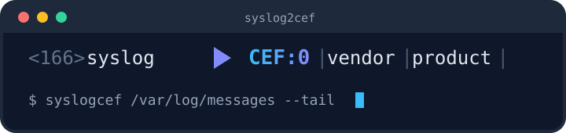

<p align="center">
  
</p>

<p align="center">
  <a href="https://github.com/allamiro/syslog2cef/actions/workflows/ci.yml"></a>
  <a href="https://pypi.org/project/syslog2cef/"></a>
  <a href="https://pypi.org/project/syslog2cef/"></a>
  <a href="https://pypistats.org/packages/syslog2cef"></a>
  <a href="https://copr.fedorainfracloud.org/coprs/allamiro/syslogcef/"></a>
  <a href="https://github.com/allamiro/syslog2cef/pkgs/container/syslog2cef"></a>
  <a href="https://github.com/allamiro/syslog2cef/actions/workflows/fuzz.yml"></a>
  <a href="https://github.com/astral-sh/ruff"></a>
  <a href="LICENSE"></a>
  <a href="CITATION.cff"></a>
</p>

# syslog2cef

syslog2cef converts syslog events into ArcSight Common Event Format (CEF). It
is a small, dependency-free Python package with a command line interface,
built for feeding syslog data from network devices and Linux hosts into SIEM
platforms that consume CEF.

## Features

- Automatic detection and parsing of multiple syslog dialects:
  RFC3164 (BSD), RFC5424 (including structured data), rsyslog JSON and
  file formats, systemd journal exports (JSON, short, and ISO formats),
  Cisco console/buffer lines, ISO-timestamp syslog, and key=value streams
  (Fortinet, Sophos). Unknown layouts are learned adaptively.
- Deterministic vendor/product mappings bundled for Cisco ASA, Cisco IOS,
  F5 BIG-IP, Fortinet FortiGate, Sophos XG Firewall, VMware ESXi, and
  generic Linux, with automatic mapping selection based on message content.
- Custom mappings supplied as JSON files or Python dictionaries, and custom
  parsers supplied as regex pattern files.
- Validation of CEF extension values against the ArcSight extension
  dictionary (`--validate`, `--strict`).
- Network receiver (`--listen udp:514`) and forwarding to UDP, TCP, or
  Kafka (`--send`), with optional rate limiting.
- Escaping of untrusted log content in both CEF header and extension
  fields, so crafted messages cannot forge header fields or split records.
- Streaming CLI with stdin/file input, tail (follow) mode across multiple
  files, optional multiprocessing, and no runtime dependencies.
- With format auto-detection (the default), malformed lines never abort a
  stream: unparseable input falls back to a raw-message event. A forced
  `--mode` instead stops with an error at the first line that parser
  rejects.

## Installation

From PyPI:

```bash
pip install syslog2cef
```

> **Naming.** The project, this repository, the PyPI distribution and the
> RPM/DEB/APK packages are all `syslog2cef`. The command you run and the
> Python package you import are `syslogcef`, unchanged — as are the config
> paths (`/etc/syslogcef/`), the systemd units and the log directory, so
> upgrading from an earlier release needs no changes. The `syslogcef` name
> on PyPI belongs to an unrelated project, which is why the distribution
> has always been `syslog2cef`.

From source:

```bash
git clone https://github.com/allamiro/syslog2cef.git
cd syslog2cef
pip install .
```

The GitHub releases page also provides, for every version:

- An RPM package (Fedora/RHEL) with a systemd service — see "Running as a
  Service" below.
- A Debian package (`syslog2cef_X.Y.Z-1_all.deb`) with the same systemd
  service: `sudo apt install ./syslog2cef_X.Y.Z-1_all.deb`.
- An Alpine APK with an OpenRC service:
  `apk add --allow-untrusted syslog2cef-X.Y.Z-r0.apk` (or install the
  signing key from [packaging/apk/syslogcef.rsa.pub](packaging/apk/syslogcef.rsa.pub)
  into `/etc/apk/keys/` first to verify).
- A standalone executable (`syslog2cef-X.Y.Z.pyz`) that runs on any system
  with Python 3.9+: `chmod +x syslog2cef-X.Y.Z.pyz && ./syslog2cef-X.Y.Z.pyz`.
- A source zip and sdist/wheel files.

A multi-arch (amd64/arm64) container image is published to GitHub
Container Registry on each release:

```bash
docker run -i ghcr.io/allamiro/syslog2cef < /var/log/syslog
```

Fedora, RHEL/Alma/Rocky 9 and 10, and CentOS Stream users can install
from the [COPR repository](https://copr.fedorainfracloud.org/coprs/allamiro/syslogcef/),
which rebuilds automatically from every commit:

```bash
sudo dnf copr enable allamiro/syslogcef
sudo dnf install syslog2cef
```

The COPR project keeps its original name (`allamiro/syslogcef`) so that
already-enabled repositories keep working; the package it builds is
`syslog2cef`.

Every asset ships with a detached GPG signature (`.asc`) and is listed in
a signed `SHA256SUMS` file; RPMs additionally carry embedded `rpmsign`
signatures. The public key is committed at
[packaging/rpm/RPM-GPG-KEY-syslogcef](packaging/rpm/RPM-GPG-KEY-syslogcef).

## Command Line Usage

<p align="center">
  
</p>

```bash
# Read from stdin, write CEF to stdout
syslogcef < /var/log/syslog

# Convert one or more files and write to an output file
syslogcef /var/log/messages /var/log/secure --output events.cef

# Follow files in real time (all files are tailed concurrently)
syslogcef /var/log/asa.log /var/log/messages --tail

# Force a parser and mapping instead of auto-detection
syslogcef asa.log --mode rfc3164 --mapping syslogcef/mappings/cisco_asa.json

# Use multiprocessing for high-volume batch conversion
syslogcef big.log --multiprocess --pool-size 4
```

Options:

| Option | Description |
| ------ | ----------- |
| `paths` | Input files; stdin is used when omitted. |
| `-o, --output FILE` | Write CEF lines to a file instead of stdout. Accepts strftime codes for timed files (see "Timed output files"). |
| `-a, --append` | Append to `--output` instead of truncating it (implied for templated paths). |
| `--mode MODE` | Parser override: `rfc3164`, `rfc5424`, `rsyslog_json`, `rsyslog_file`, `journald_json`, `journald_short`, `journald_iso`, `cisco_seq`, `iso_syslog`, `kv`, or a name from `--patterns`. Auto-detected when omitted. |
| `--mapping FILE` | Mapping JSON file. Auto-selected from message content when omitted. |
| `--patterns FILE` | Custom parser patterns (see "Custom Parsers"); may be repeated. |
| `--check-patterns` | Run the `examples` in every `--patterns` file, print `PASS`/`FAIL` per example (and a `FAIL` line per unknown key), and exit 1 if any fail. Takes no input. |
| `--tail` | Follow input files like `tail -f`. |
| `--listen PROTO:PORT` | Receive syslog over the network instead of files/stdin: `udp:514`, `tcp:5514`, or `udp:10.0.0.5:514`. |
| `--send URL` | Forward CEF to `udp://HOST:PORT`, `tcp://HOST:PORT`, or `kafka://BROKER:PORT/TOPIC` (needs the `kafka` extra). |
| `--eps N` | Rate-limit `--send` to at most N events per second. |
| `--multiprocess` | Convert lines using a process pool. |
| `--pool-size N` | Worker count for `--multiprocess` (default: CPU count minus one). |
| `--validate` | Check CEF extensions against the ArcSight dictionary; violations are logged as warnings. |
| `--strict` | Like `--validate`, but exit with an error on type or length violations. |
| `--explain` | Print, per input line, the parser, matched patterns, mapping, all fields, and the CEF record instead of bare CEF. Not with `--output`, `--send`, or `--multiprocess`. |
| `--stats` | After input ends, print line counts by parser and by msg pattern, plus the first unmatched lines, to stderr. Not with `--multiprocess`. |
| `--log-level LEVEL` | Python logging level (default `WARNING`). |
| `--version` | Print the version, copyright, license and author, then exit. |

`python -m syslogcef` is equivalent to the `syslogcef` entry point.

## Python API

High-level, one call per line:

```python
from syslogcef import convert_line

line = "<166>Jan  1 12:34:56 fw01 %ASA-6-302013: Built inbound TCP connection src=10.0.0.1 dst=10.0.0.2"
print(convert_line(line))
```

Lower-level pipeline when granular control is required:

```python
from syslogcef import parse_syslog, normalize_event, to_cef

parsed = parse_syslog(line)          # ParsedEvent: pri, timestamp, host, app, msg, ...
normalized = normalize_event(parsed) # adds key/value pairs, event codes, derived fields
cef = to_cef(normalized, mapping="my_mapping.json")
```

Bundled mappings are importable from `syslogcef.mappings` (`CISCO_ASA`,
`CISCO_IOS`, `F5`, `FORTINET`, `LINUX`, `SOPHOS`, `VMWARE`, or
`load_mapping(name)`).

## Mapping Files

A mapping is a JSON object that controls the CEF header and extension
fields. Values are Python %-format templates resolved against the
normalized event's fields:

```json
{
  "deviceVendor": "Cisco",
  "deviceProduct": "ASA",
  "deviceVersion": "auto",
  "eventClassId": "asa.%(event_code)s",
  "name": "%(message_short)s",
  "severity_map": { "6": "2", "3": "6" },
  "extensions": {
    "src": "%(src)s",
    "dst": "%(dst)s",
    "cs1Label": "rawEvent",
    "cs1": "%(raw)s"
  }
}
```

- Header keys: `deviceVendor`, `deviceProduct`, `deviceVersion`,
  `eventClassId`, `name`.
- `severity_map` translates syslog severity (0-7) to CEF severity (0-10);
  unmapped values pass through.
- `extensions` maps CEF extension keys to templates. Extensions that
  resolve to an empty value are omitted, and so is a custom-field label
  (`cs1Label`, `cn1Label`, ...) whose paired value is omitted.
- Available template fields include `host`, `app`, `pid`, `msgid`, `msg`,
  `message_short` (first 120 characters), `raw`, `raw_kv`, `event_code`,
  `facility`, `severity`, `ts`, plus every key=value pair extracted from
  the message, any RFC5424 structured-data or journald fields, and the
  named groups captured by pattern files (see "Custom Parsers").

Field templates that reference missing keys resolve to an empty string
rather than failing the event. Mapping files and Python mapping dictionaries
are validated before rendering; malformed templates, severity maps, and CEF
extension keys fail with a configuration error instead of corrupting a record.
See [docs/cef_fields.md](docs/cef_fields.md) for the full CEF extension
dictionary.

## Timestamps without a year

RFC3164, journald short, Cisco console lines and many device formats
stamp `Jan  1 12:34:56` with no year. syslogcef dates such a timestamp to
its most recent occurrence that is not more than one day ahead of the
current time: log lines describe events that already happened. A `Jan 1`
line converted in November is dated January of the current year, while a
line stamped just after midnight on New Year's Eve (a sender clock or
timezone slightly ahead) lands in the new year. Pass `now=` to
`parse_syslog`/`convert_line` to date archived files relative to when
they were written.

## Field Dictionary

`syslogcef/dictionary.json` is the single source of truth for CEF field
knowledge, derived from the ArcSight Extension Dictionary (see
[docs/cef_fields.md](docs/cef_fields.md)):

- **Key metadata** — data type, maximum length, and producer/consumer
  scope for every CEF key. `--validate`/`--strict` check types and
  lengths from it, and warn (without failing) when producer output sets
  a consumer-side key such as `rawEvent`.
- **Field aliases** — common source-log names mapped to canonical CEF
  keys: `srcip`/`source_ip` → `src`, `dstport` → `dpt`, `user` →
  `suser`, `rcvdbyte` → `in`, `action` → `act`, and ~50 more. Aliases
  are applied during normalization for **every** event — including
  key=value pairs extracted from adaptively-parsed unknown formats — so
  mappings and validation always see canonical names. Original keys are
  preserved and an explicit canonical key is never overwritten. Source key
  casing is normalized as well (`SRCIP`, `SrcIp`, and `srcip` all make `src`
  available), while parsed syslog envelope fields such as host and severity
  remain authoritative over same-named text in the message.

This means a Fortinet-style `srcip=10.1.1.1 dstport=443` and an unknown
device emitting the same pairs behind an unrecognized prefix both end up
with `src` and `dpt` available to mapping templates, with no per-device
configuration.

## Custom Parsers

When a device's messages carry values syslogcef does not pick out, or its
header format is not recognized at all, a pattern file teaches it the format
without any code. Named regex groups become fields, and a mapping turns
them into CEF extensions:

```json
{
  "patterns": [
    {
      "name": "sshd_auth",
      "match": "msg",
      "app": ["sshd", "sshd-session"],
      "regex": "^(?P<outcome>Accepted|Failed) %{NOTSPACE:auth_method} for (?:invalid user )?%{USER:suser} from %{IP:src} port %{PORT:spt}",
      "mapping": "sshd-mapping.json",
      "examples": [
        {
          "line": "<38>Nov 21 10:15:09 bastion sshd[2214]: Accepted publickey for deploy from 198.51.100.4 port 40022 ssh2",
          "expect": {"outcome": "Accepted", "suser": "deploy", "src": "198.51.100.4", "spt": 40022}
        }
      ]
    }
  ]
}
```

```bash
syslogcef --stats /var/log/secure > /dev/null          # which lines need work
syslogcef --explain --patterns sshd.json < sample.log  # what each line becomes
syslogcef --patterns sshd.json --check-patterns        # run the examples
syslogcef --patterns sshd.json /var/log/secure         # convert
```

- `"match": "msg"` patterns read fields out of the message after the
  header is parsed; `"match": "line"` (the default) patterns parse a whole
  line whose header no built-in parser knows, filling `pri`, `host`, `app`,
  `pid`, `msgid`, `msg`, and `ts` (with `timestamp_format`).
- Shorthands such as `%{IP:src}`, `%{PORT:spt}` and `%{USER:suser}` stand
  in for tested regexes. Named groups other than those header fields
  become fields that mapping templates can use (`%(src)s`).
- `mapping` (a bundled mapping name or a JSON file next to the pattern
  file) applies to the events the pattern matches; `--mapping` still wins.
- Files are validated at startup, so a bad regex or mapping fails with a
  clear message instead of mid-stream. An unknown key (often a typo such
  as `"exmaples"`) is ignored with a warning, and `--check-patterns`
  reports it as a failure. Use `description` for notes. Pattern names also
  work as `--mode` values.
- In the service, set `EXTRA_ARGS=--patterns /etc/syslogcef/patterns/sshd.json`.
- Your regexes run against untrusted log content: anchor them and avoid
  nested quantifiers (ReDoS).

[docs/patterns.md](docs/patterns.md) is the full guide: a step-by-step
OpenSSH walkthrough, every pattern key, the shorthand table, examples,
error messages, and troubleshooting. Ready-to-use files are in
[examples/patterns/](examples/patterns/).

From Python, load the same files or register full parser functions:

```python
from syslogcef import register_parser, load_patterns

load_patterns("patterns.json")               # same file format
register_parser("marker", my_parse_fn)       # fn(line) -> ParsedEvent | None
```

## Running as a Service

The RPM and Debian packages install a systemd unit and an environment
file (the Alpine APK installs the equivalent OpenRC service with its
configuration in `/etc/conf.d/syslogcef`):

- `/etc/syslogcef/syslogcef.conf` — input file, output file, and extra
  arguments for the converter.
- `syslogcef.service` — runs `syslogcef --tail` against the configured
  input and appends CEF to the configured output.
- `syslogcef@.service` — template unit for running several independent
  pipelines from `/etc/syslogcef/conf.d/` (see below).
- `/etc/logrotate.d/syslogcef` — daily rotation for flat `.cef` archives.

```bash
sudo dnf install syslog2cef-*.rpm
sudo vi /etc/syslogcef/syslogcef.conf
sudo systemctl enable --now syslogcef
```

The environment file has three variables; everything else goes through
`EXTRA_ARGS`, which accepts any command line flag (`--mode`, `--mapping`,
`--listen`, `--send`, `--eps`, `--validate`, `--strict`,
`--multiprocess`, `--log-level`, ...):

```bash
# File(s) to follow for new syslog lines, separated by spaces.
INPUT_FILE=/var/log/messages

# File that converted CEF events are appended to.
OUTPUT_FILE=/var/log/syslogcef/events.cef

# Extra arguments; leave INPUT_FILE empty and use --listen for a
# network daemon: EXTRA_ARGS=--listen udp:514 --send tcp://siem:514
EXTRA_ARGS=
```

### Timed output files

`OUTPUT_FILE` (and `--output` generally) accepts strftime codes; the
file is reopened whenever the rendered path changes and parent
directories are created automatically:

```bash
# New file each hour, grouped in a directory per day:
OUTPUT_FILE=/var/log/syslogcef/%Y-%m-%d/events-%H.cef
```

Unsupported `%` codes are rejected at startup (use `%%` for a literal
percent). Keep templated outputs in a dated subdirectory as shown above:
the installed logrotate snippet rotates every flat `.cef` file directly
under `/var/log/syslogcef/`, and a templated file rendering flat there
would be rotated twice. Prefer a stable filename if a downstream
collector reads the archive — flat files are rotated daily by logrotate
instead.

### Multiple pipelines (one input per output)

To map specific inputs to specific outputs, run one instance of the
template unit per pipeline. Each instance reads its own file in
`/etc/syslogcef/conf.d/` (a commented `example.conf.sample` is
installed there) and has independent restart, logs, and options:

```bash
sudo cp /etc/syslogcef/conf.d/example.conf.sample /etc/syslogcef/conf.d/secure.conf
sudo cp /etc/syslogcef/conf.d/example.conf.sample /etc/syslogcef/conf.d/firewall.conf
sudo vi /etc/syslogcef/conf.d/secure.conf     # /var/log/secure  -> secure.cef
sudo vi /etc/syslogcef/conf.d/firewall.conf   # --listen udp:514
sudo systemctl enable --now syslogcef@secure syslogcef@firewall
```

On Alpine, OpenRC gets the same result with symlinked services:

```bash
sudo ln -s syslogcef /etc/init.d/syslogcef.firewall
sudo cp /etc/conf.d/syslogcef /etc/conf.d/syslogcef.firewall
sudo vi /etc/conf.d/syslogcef.firewall   # set a distinct INPUT_FILE and OUTPUT_FILE
sudo rc-update add syslogcef.firewall && sudo rc-service syslogcef.firewall start
```

Give every instance its own `INPUT_FILE` and `OUTPUT_FILE` — two
instances sharing them would process the same events twice and append
to the same file concurrently.

See [packaging/rpm/](packaging/rpm/) for the spec file and build
instructions, including GPG signing of the RPM.

## Security

Log content is treated as untrusted input. Header and extension values are
escaped per the CEF specification before rendering, and CR/LF in header
fields are replaced with spaces so records cannot be split or spoofed. To
report a vulnerability, see [SECURITY.md](SECURITY.md) — please do not open
public issues for security reports.

## Development

```bash
git clone https://github.com/allamiro/syslog2cef.git
cd syslog2cef
python -m venv .venv
source .venv/bin/activate
pip install -e .[test]
pytest
```

Contributions are welcome — see [CONTRIBUTING.md](CONTRIBUTING.md). Notable
changes are tracked in [CHANGELOG.md](CHANGELOG.md).

## Citation

If you use syslog2cef in research or published work, please cite it. The
metadata is in [CITATION.cff](CITATION.cff), and GitHub's "Cite this
repository" button produces APA and BibTeX from it.

```bibtex
@software{suliman_syslog2cef,
  author  = {Suliman, Tamir},
  title   = {syslog2cef: Convert syslog to ArcSight Common Event Format (CEF)},
  version = {0.4.2},
  year    = {2026},
  url     = {https://github.com/allamiro/syslog2cef},
  license = {MIT}
}
```

## License

MIT — see [LICENSE](LICENSE). Copyright (c) Tamir Suliman.
